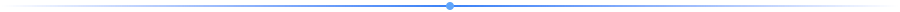
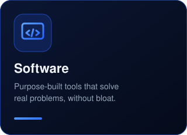
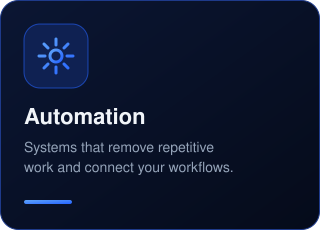
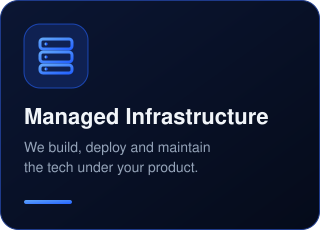

 

**You run the operation. We build and manage the technology behind it.**

 

  

## What We Build

Practical software and automation for businesses that want the benefits of modern technology, without building or maintaining the infrastructure behind it.

<table>
<tr>
<td align="center"></td>
<td align="center"></td>
<td align="center"></td>
</tr>
</table>

## Open Source

We publish useful standalone tools from our engineering work.

<table>
<tr>
<td width="50%" valign="top">

### 🌐 Browser Agent

Give AI coding agents a real browser to inspect and test their work.

Detect broken buttons, failed requests, JavaScript errors, broken links and layout problems that are invisible from the source code alone.

**[View Browser Agent →](https://github.com/samstacksys/browser-agent)**

</td>
<td width="50%" valign="top">

### 📍 Niche Lead Finder

Find public business data by niche and location.

A simple standalone tool for finding and organizing relevant businesses, with export-ready results.

**[View Niche Lead Finder →](https://github.com/samstacksys/niche_lead_finder)**

</td>
</tr>
</table>

## Why We Open Source

Useful software doesn't always need to sit behind a subscription. We release selected tools publicly so anyone can use them, inspect the source, improve them and build on top of them.

Our commercial work goes further: integrated products, automation and infrastructure that we deploy, maintain and continuously improve for our customers.

### Build the business. We'll handle the technology.

[Open Source](https://github.com/samstacksys?tab=repositories) · Samstack Systems

